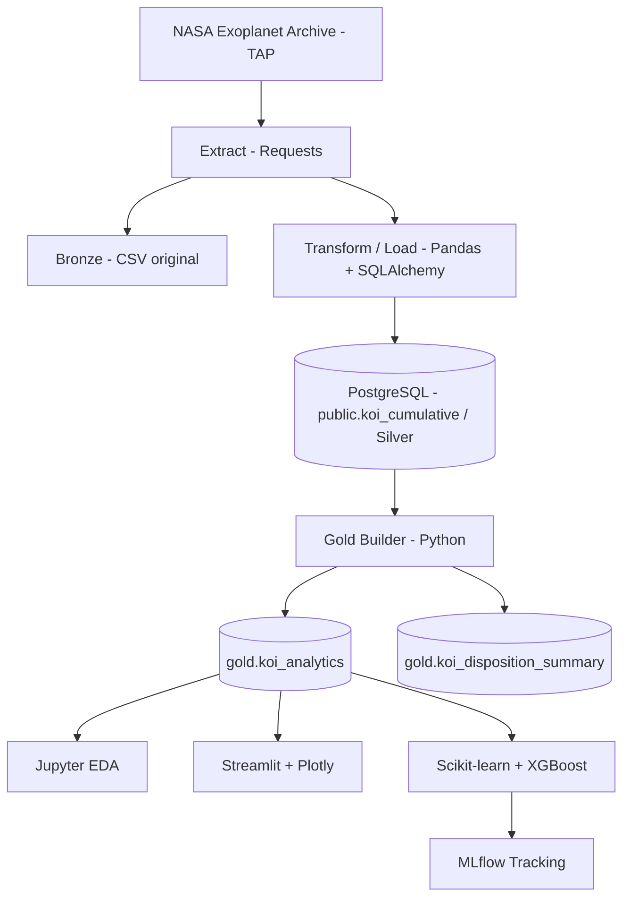

# KOI Exoplanet — Data Engineering & Machine Learning

Pipeline ponta a ponta baseado na tabela **KOI Cumulative** do [NASA Exoplanet Archive](https://exoplanetarchive.ipac.caltech.edu/). O projeto integra ingestão de dados, modelagem analítica, EDA, classificação multiclasse e rastreamento de experimentos.

## Objetivos

- Extrair o CSV KOI Cumulative por meio do serviço TAP do NASA Exoplanet Archive.
- Armazenar o snapshot bruto e carregar a camada Silver no PostgreSQL.
- Construir tabelas analíticas na camada Gold.
- Explorar os dados em Jupyter e em um dashboard Streamlit.
- Treinar e comparar Logistic Regression, Random Forest e XGBoost.
- Registrar parâmetros, métricas, artefatos e modelos no MLflow.

## Arquitetura



## Estrutura do repositório

```text
koi_cumulative_etl/
├── dashboard/
│   └── app.py
├── data/raw/                         # CSVs originais (não versionados)
├── logs/                              # Logs (não versionados)
├── ml/
│   ├── features.py                    # Seleção de atributos e prevenção de leakage
│   └── train.py                       # Treinamento, avaliação e MLflow
├── notebooks/
│   └── 01_exploratory_data_analysis.ipynb
├── reports/                           # Comparação e métricas (gerados)
├── sql/
│   └── gold_queries.sql
├── src/
│   ├── config.py
│   ├── extract.py
│   ├── transform.py
│   ├── load.py
│   ├── gold.py                        # Construção da camada Gold
│   └── main.py                        # ETL de ingestão
├── tests/
│   └── test_features.py
├── .env.example
├── Dockerfile
├── docker-compose.yml
└── requirements.txt
```

## Camadas de dados

| Camada | Objeto | Descrição |
|---|---|---|
| Bronze | `data/raw/*.csv` | Arquivo original retornado pelo TAP, preservado para auditoria. |
| Silver | `public.koi_cumulative` | Snapshot carregado pelo ETL, mantendo os campos originais como texto. |
| Gold | `gold.koi_analytics` | Dataset curado, com alvo padronizado e atributos numéricos tipados. |
| Gold | `gold.koi_disposition_summary` | Quantidade e percentual por classe de disposição. |

A camada Gold é reconstruída a partir da Silver com `python -m src.gold`. Os campos numéricos são convertidos para tipos numéricos e valores inválidos viram nulos. A tabela de resumo permite acompanhar o desbalanceamento entre classes.

## Problema de Machine Learning

**Classificação multiclasse:** O objetivo é prever os KOI(Kepler Object of Interest) que são exoplanetas, na base sendo considetado como `CONFIRMED`, na coluna `koi_disposition` com as classes sendo:

- `CONFIRMED`
- `CANDIDATE`
- `FALSE POSITIVE`

A lista de atributos é explicitamente permitida em `ml/features.py`: período orbital, época de trânsito, impacto, duração, profundidade, raio estimado, temperatura de equilíbrio, insolação, SNR e propriedades estelares/posição.

Para reduzir *target leakage*, não entram como preditores `koi_pdisposition`, `koi_score`, `koi_fpflag_nt`, `koi_fpflag_ss`, `koi_fpflag_co` e `koi_fpflag_ec`. Identificadores também não são usados como features. Essa seleção é uma decisão inicial de modelagem e deve ser revisitada com base no dicionário de dados e no objetivo científico.

### Modelos comparados

1. Logistic Regression — baseline linear.
2. Random Forest — ensemble de árvores.
3. XGBoost — gradient boosting.

O split é estratificado (80% treino / 20% teste), com `random_state=666`. Imputação e escalonamento ficam dentro de pipelines para evitar ajuste usando dados de teste. O XGBoost recebe pesos de classe calculados no conjunto de treino.

### Métricas

- Accuracy
- Balanced Accuracy
- Precision macro
- Recall macro
- F1 macro (critério principal de comparação)
- F1 weighted
- Matriz de confusão e relatório por classe

## Execução com Docker

### 1. Configurar variáveis

```bash
cp .env.example .env
```

Edite `.env` e defina uma senha forte. Se o volume PostgreSQL já tiver sido inicializado, mudar `POSTGRES_PASSWORD` no `.env` não altera a senha existente; use `ALTER USER postgres WITH PASSWORD 'nova_senha';` dentro do banco, ou recrie o volume apenas se puder perder os dados.

### 2. Subir o PostgreSQL

```bash
docker compose up -d postgres
```

### 3. Executar a ingestão (Silver)

```bash
docker compose --profile etl run --rm etl
```

### 4. Construir a camada Gold

```bash
docker compose --profile analytics run --rm gold
```

### 5. Iniciar MLflow

```bash
docker compose --profile ml up -d mlflow
```

Interface: http://localhost:5000

### 6. Treinar e comparar os modelos

```bash
docker compose --profile ml run --rm trainer
```

Os runs serão registrados no experimento `koi-disposition-classification`. A saída local inclui `reports/model_comparison.csv`, relatórios JSON e matrizes de confusão. No MLflow ficam parâmetros, métricas, metadados, artefatos e modelos serializados.

### 7. Iniciar o dashboard

```bash
docker compose --profile analytics up -d dashboard
```

Dashboard: http://localhost:8501

### 8. Notebook EDA

Abra `notebooks/01_exploratory_data_analysis.ipynb` no Jupyter/VS Code. Para executar localmente, instale `requirements.txt`, configure `.env` com `POSTGRES_HOST=localhost` e execute o notebook a partir da raiz do repositório.

## Execução local sem Docker

```bash
python -m venv .venv
# Windows: .venv\Scripts\activate
# Linux/macOS: source .venv/bin/activate
pip install -r requirements.txt
cp .env.example .env
```

Com PostgreSQL e servidor MLflow disponíveis:

```bash
python -m src.main       # ingestão
python -m src.gold       # Gold
python -m ml.train       # treinamento e tracking
streamlit run dashboard/app.py
```

## MLflow: rastreamento e gerenciamento

Cada modelo gera um run no mesmo experimento. São registrados:

- Hiperparâmetros do estimador;
- hash SHA-256 do dataset Gold usado;
- revisão Git (quando disponível);
- nome do alvo, features, tamanho dos conjuntos e classes;
- métricas agregadas;
- relatório de classificação e matriz de confusão;
- pipeline treinado e assinatura de entrada/saída.

A versão do conjunto de dados é identificada pelo hash do conteúdo usado no treinamento. Para rastreabilidade completa em produção, recomenda-se também versionar os snapshots Bronze e registrar a data/hora de ingestão.

## Fonte de dados e documentação

- [NASA Exoplanet Archive — KOI Cumulative](https://exoplanetarchive.ipac.caltech.edu/cgi-bin/TblView/nph-tblView?app=ExoTbls&config=cumulative)
- [NASA Exoplanet Archive — TAP](https://exoplanetarchive.ipac.caltech.edu/docs/TAP/usingTAP.html)
- [Scikit-learn](https://scikit-learn.org/stable/)
- [XGBoost](https://xgboost.readthedocs.io/)
- [MLflow Tracking](https://mlflow.org/docs/latest/ml/tracking/)


### Correção de acesso ao MLflow em Docker

O serviço MLflow permite explicitamente os hosts `mlflow:5000`, `localhost:5000` e `127.0.0.1:5000` por meio de `--allowed-hosts`. Se alterar o hostname ou a porta, atualize essa lista. Depois recrie o serviço:

```bash
docker compose --profile ml down
docker compose --profile ml up -d --build mlflow
docker compose --profile ml run --rm trainer
```

